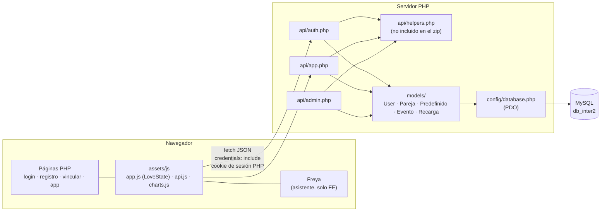
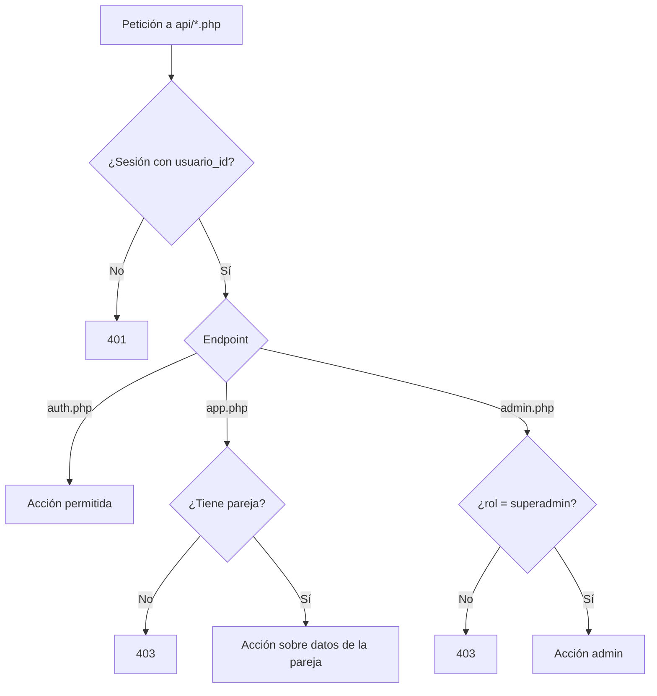
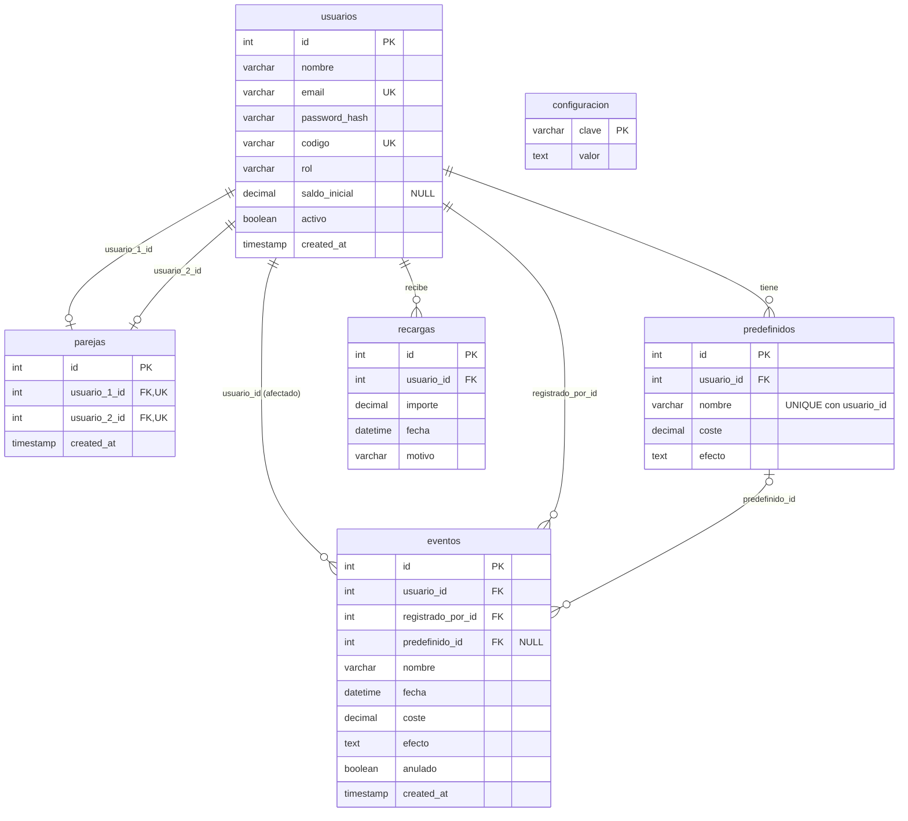
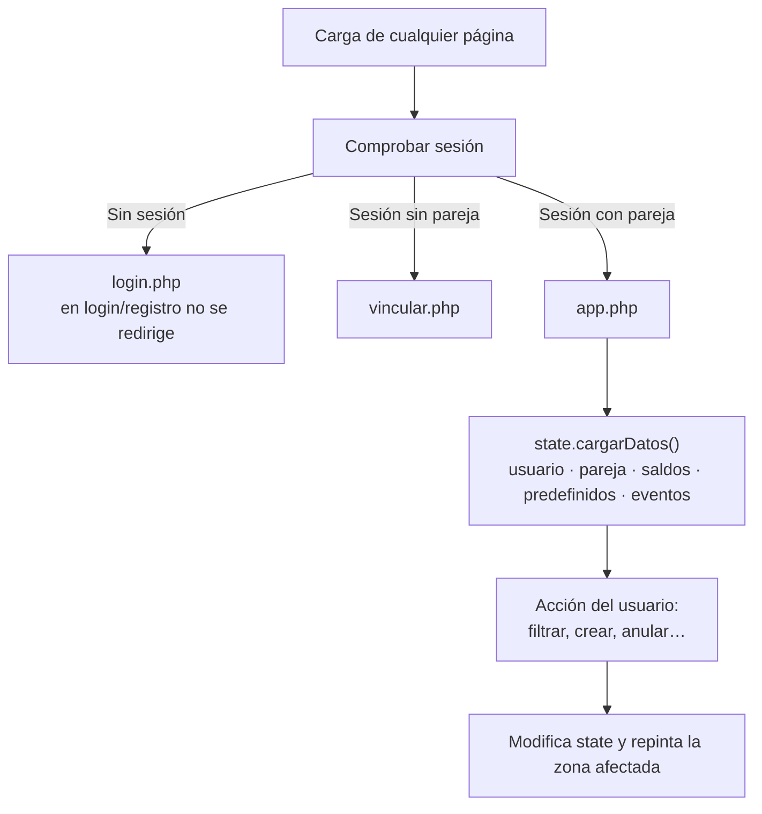

# ARCHITECTURE.md — LovePoints

> Documento generado a partir de los repositorios `LovePoints-feature-backend` y `LovePoints-feature-frontend`.
> Describe lo que **existe hoy en el código**; lo que está solo planificado (TODOs, sprints) se indica expresamente.

---

## 1. Qué es LovePoints

Aplicación web para **parejas** que gamifica el reparto de tareas y gestos del día a día mediante un saldo de "puntos" (monedas). Cada persona tiene un saldo; los **eventos** (por ejemplo "Lavar los platos") lo modifican según un efecto `resta` o `suma`, y las **recargas** lo incrementan manualmente. Una asistente visual llamada **Freya** guía al usuario en el front.

> **Nota sobre el nombre:** el producto aparece como *LovePoints* (front, README, logo) y como *FamilyCoinsApp* (`api.md`, `index.php` y cabecera del panel admin del back, moneda `Coins` en la tabla `configuracion`). Conviene unificarlo.

### Conceptos de dominio

| Concepto | Descripción |
|---|---|
| **Usuario** | Persona registrada. Tiene `rol` (`usuario` o `superadmin`), un `codigo` personal (3 letras + 4 dígitos, ej. `ABC1234`) y un `saldo_inicial` opcional. |
| **Pareja** | Vínculo 1-a-1 entre dos usuarios. Se crea introduciendo el código del otro. Un usuario solo puede estar en una pareja. |
| **Predefinido** | Plantilla de evento reutilizable (nombre, coste, efecto) propia de cada usuario. |
| **Evento** | Hecho registrado sobre un usuario de la pareja, con fecha, coste y efecto. Se puede **anular** (no se borra). |
| **Recarga** | Ingreso manual de puntos a un usuario, con importe y motivo. |
| **Saldo** | Resultado calculado: `saldo_inicial + recargas + efecto de los eventos no anulados`. |

---

## 2. Vista general del sistema



**Estilo arquitectónico:** aplicación **monolítica clásica en PHP** con separación en dos capas desplegables:

- **Front-End**: páginas PHP casi estáticas (cascarones HTML) + JavaScript vanilla que consume la API. Sin framework, sin bundler.
- **Back-End**: API REST-like en PHP procedural (endpoints) + clases de acceso a datos (modelos) sobre PDO/MySQL. Sesiones nativas de PHP.

Los dos repositorios están pensados para fusionarse en un único documento raíz (ambos comparten `app.php`, `login.php`, `registro.php`, `vincular.php`, `README.md`).

---

## 3. Stack tecnológico

| Capa | Tecnología |
|---|---|
| Lenguaje servidor | PHP 8+ (usa `str_contains`, tipos de retorno nullable, `declare`-less) |
| Base de datos | MySQL / MariaDB, acceso mediante **PDO** con sentencias preparadas |
| Autenticación | Sesión nativa de PHP (`$_SESSION`), cookie de sesión |
| Hash de contraseñas | `password_hash` / `password_verify` (bcrypt por defecto) |
| Front-End | HTML + CSS (mobile-first, variables CSS) + JavaScript vanilla (clases ES6) |
| Gráficas | **Chart.js** (previsto, vía cdnjs; aún sin implementar) |
| Almacenamiento cliente | `sessionStorage` (mensajes de Freya) y `localStorage` (preferencias de Freya) |
| Diseño | Wireframes en `docs/wireframes` (PNG + PDF), paleta "Lavanda y rosa", fuentes del sistema |

---

## 4. Estructura de carpetas

### 4.1 Back-End (`LovePoints-feature-backend/`)

```
├── api/
│   ├── auth.php        # Registro, login, logout, sesión, código, vinculación de pareja
│   ├── app.php         # Predefinidos, eventos, recargas, saldos, estadísticas
│   ├── admin.php       # Gestión de usuarios y parejas (solo superadmin)
│   └── helpers.php     # ⚠ REFERENCIADO PERO NO INCLUIDO en el zip
├── models/
│   ├── user.php        # Usuarios: alta, consulta, actualización, baja lógica, código único
│   ├── pareja.php      # Parejas: consulta por usuario, crear, eliminar
│   ├── predefinido.php # CRUD de plantillas de evento
│   ├── evento.php      # CRUD de eventos + regla del efecto (aplicarEfecto)
│   └── recarga.php     # Listado, alta y borrado de recargas
├── config/
│   └── database.php    # Clase Database::connect() → PDO
├── admin/
│   ├── usuarios.php    # Panel HTML de administración (renderizado en servidor)
│   └── pasajeros.php   # Vacío (0 bytes)
├── db.sql              # Esquema + datos de prueba (BD db_inter2)
├── api.md              # Documentación de la API
├── index.php           # Landing mínima
├── app.php, login.php, registro.php, vincular.php   # Vacíos (0 bytes) en este repo
└── README.md, .gitignore
```

### 4.2 Front-End (`LovePoints-feature-frontend/`)

```
├── app.php             # Pantalla principal (<main id="app"> + <aside id="freya">)
├── login.php           # <main id="login">
├── registro.php        # <main id="registro">
├── vincular.php        # <main id="vincular">
├── assets/
│   ├── css/style.css   # Variables, base y estilos (paleta, tipografía, espaciados)
│   ├── js/
│   │   ├── app.js      # Clase LoveState + instancia global `state`
│   │   ├── api.js      # Capa de llamadas fetch (vacía, solo comentario)
│   │   └── charts.js   # Gráficas Chart.js (vacío, TODO Sprint 5)
│   └── img/            # logo.svg, logo-nombre.svg, freya.svg, freya-cara.svg
└── docs/
    ├── FREYA.md        # Especificación del asistente Freya
    └── wireframes/     # 7 pantallas en PNG + PDF v1
```

---

## 5. Back-End en detalle

### 5.1 Patrón de endpoints

Cada archivo de `api/` es un **controlador de enrutado por acción**: lee `?accion=...`, lo normaliza (`strtolower(trim(...))`) y entra en un `switch`. El cuerpo se obtiene con `get_input()` (JSON). Las respuestas siempre llevan `ok` (`true`/`false`) y, si falla, `error`.

Funciones auxiliares usadas (definidas en `api/helpers.php`, **no incluido**; se deduce su contrato del uso):

| Helper | Función inferida |
|---|---|
| `get_input()` | Devuelve el cuerpo JSON como array. |
| `json_response($data, $code = 200)` | Emite JSON y termina. |
| `json_error($msg, $code = 400)` | Emite `{ok:false, error}` y termina. |
| `require_method('GET'\|'POST')` | Valida el método HTTP. |
| `require_login()` | Exige sesión; devuelve `usuario_id`. |
| `require_pareja()` | Exige sesión **y** pareja; devuelve `usuario_id`. |
| `require_superadmin()` | Exige rol `superadmin`. |
| `get_pareja($id)` / `get_pareja_id($id)` | Fila de pareja / id de la pareja del usuario. |
| `require_miembro_pareja($uid)` | Verifica que `$uid` sea uno de los dos miembros de la pareja del usuario en sesión. |
| `validar_coste`, `validar_fecha`, `validar_efecto`, `validar_codigo` | Validación y normalización de entradas. |
| `session_start()` | Ha de iniciarse aquí (el panel `admin/usuarios.php` lo hace por su cuenta). |

### 5.2 Endpoints

Resumen; el detalle completo con ejemplos está en `api.md`.

**`api/auth.php`** (público / sesión)

| Acción | Método | Descripción |
|---|---|---|
| `register` | POST | Crea usuario con código único. Contraseña ≥ 8 caracteres y 1 mayúscula. 201 / 400 / 409. |
| `login` | POST | Verifica credenciales y usuario activo; guarda `usuario_id`, `rol`, `nombre` en sesión. |
| `logout` | POST | Destruye la sesión. |
| `check` | GET | Devuelve si hay sesión, datos básicos y `tiene_pareja`. |
| `mi_codigo` | GET | Código personal del usuario. |
| `vincular` | POST | Crea la pareja a partir del código del otro usuario. |
| `pareja` | GET | Datos de la pareja (id, nombre, código, saldo inicial). |

**`api/app.php`** (requiere login + pareja)

| Grupo | Acciones |
|---|---|
| Predefinidos | `predefinidos_list`, `predefinido_get`, `predefinido_create`, `predefinido_update`, `predefinido_delete` |
| Eventos | `eventos_list` (filtros: `usuario`, `efecto`, `desde`, `hasta`, `nombre`, `anulado`, `orden`, `dir`), `evento_get`, `evento_create`, `evento_update`, `evento_anular` |
| Recargas | `recargas_list`, `recarga_create`, `recarga_delete` |
| Cálculos | `saldos`, `stats` (`granularidad` = `mes` \| `trimestre` \| `año`, con `desde`/`hasta` opcionales) |

**`api/admin.php`** (requiere `superadmin`)

`usuarios_list`, `usuario_get`, `usuario_create`, `usuario_update`, `usuario_baja` (baja lógica; no permite dar de baja a un superadmin), `pareja_set` (elimina las parejas previas de ambos usuarios y crea la nueva).

### 5.3 Modelos (capa de datos)

Cada modelo abre su propia conexión con `Database::connect()` y expone métodos CRUD con sentencias preparadas.

| Modelo | Responsabilidad destacable |
|---|---|
| `User` | Genera código único `AAA0000` comprobando colisiones; `update` solo acepta una lista blanca de columnas (`nombre`, `email`, `rol`, `activo`, `saldo_inicial`); `getByCodigo` filtra por `activo = TRUE`. |
| `Pareja` | `getByUsuario`, `crear`, `eliminarPorUsuario`. |
| `Predefinido` | Todo acotado por `usuario_id` (un usuario solo ve/edita los suyos). |
| `Evento` | `list` con filtros dinámicos y ordenación por lista blanca (`fecha`, `coste`, `usuario`); contiene la **regla del efecto** (ver 5.4). |
| `Recarga` | `delete` comprueba que la recarga pertenezca a alguno de los miembros de la pareja. |

### 5.4 Regla de negocio central: el efecto de un evento

Implementada en `Evento::aplicarEfecto()` (única fuente de verdad, "regla 3" del briefing):

| `efecto` | Sobre el usuario del evento | Sobre su pareja |
|---|---|---|
| `resta` | `−coste` | `0` |
| `suma` | `0` | `+coste` |

Un evento `anulado` aporta siempre `0`.

**Saldo** de un usuario (calculado en `saldos`):

```
saldo = saldo_inicial (0 si es NULL)
      + Σ recargas del usuario
      + Σ aplicarEfecto(evento, usuario, pareja)   // eventos no anulados
```

**Estadísticas** (`stats`): agrupa eventos no anulados por periodo (`YYYY-MM`, `YYYY-Qn` o `YYYY`) y devuelve, por persona, el **gasto** = `−aplicarEfecto(...)`. Por tanto, un evento `suma` aparece como gasto *negativo* en la pareja que recibe los puntos.

### 5.5 Autenticación y autorización



Reglas de aislamiento de datos aplicadas en `app.php`:

- **Predefinidos**: solo del usuario en sesión.
- **Eventos / recargas**: solo de los dos miembros de la pareja (`usuario_id IN (yo, pareja)`); al crear/editar se valida con `require_miembro_pareja`.
- `registrado_por_id` guarda quién creó el evento (el usuario en sesión), distinto de `usuario_id` (a quién afecta).

### 5.6 Modelo de datos (`db.sql`, BD `db_inter2`)



Restricciones relevantes:

- `parejas`: `usuario_1_id` y `usuario_2_id` son `UNIQUE` (un usuario solo en una pareja) y existe un `CHECK` que impide `usuario_1_id = usuario_2_id`.
- `predefinidos`: `UNIQUE (usuario_id, nombre)`; el controlador traduce la violación a un 409.
- Borrados en cascada desde `usuarios`; `predefinido_id` pasa a `NULL` si se borra el predefinido.
- `configuracion` (`moneda_nombre`, `sistema_activo`, `version_app`) existe en el esquema **pero ningún código la usa todavía**.
- El script carga datos de ejemplo: 4 usuarios, 1 superadmin (`admin@familycoins.local`), 2 parejas, predefinidos, eventos y recargas.

### 5.7 Panel de administración

`admin/usuarios.php` se renderiza **en servidor**: comprueba la sesión y el rol `superadmin` (si no, redirige a `../login.php`), lista usuarios y parejas con `htmlspecialchars` para escapar la salida, y delega las acciones (editar, dar de baja, eliminar/asignar pareja) en `assets/js/admin.js`, que **no existe** en ninguno de los dos repos.

---

## 6. Front-End en detalle

### 6.1 Páginas

Cuatro páginas PHP, cada una un cascarón con un `<main id="...">` que JavaScript rellenará, más el hueco `<aside id="freya" aria-live="polite">`:

| Página | Contenedor | Previsto (TODO) |
|---|---|---|
| `login.php` | `#login` | Formulario con validación en cliente (Sprint 3) |
| `registro.php` | `#registro` | Email válido y contraseña con 1 mayúscula (Sprint 3) |
| `vincular.php` | `#vincular` | Mostrar mi código y pedir el de la pareja, 3 letras + 4 dígitos (Sprint 3) |
| `app.php` | `#app` | Saldos, tabla de eventos con filtros, predefinidos y recargas (Sprint 4); gráficas (Sprint 5) |

Al ser **páginas separadas** (no SPA), el estado en memoria se pierde en cada navegación; de ahí el uso de `sessionStorage` para lo que debe sobrevivir.

### 6.2 Estado global: `LoveState` (`assets/js/app.js`)

Una única instancia global `state`. Campos:

| Campo | Contenido |
|---|---|
| `usuario`, `pareja` | Usuario autenticado y datos de la pareja (`null` si no hay). |
| `saldos` | Saldos calculados por el BE. |
| `eventos`, `predefinidos` | Listas cargadas desde la API. |
| `filtros` | `persona`, `efecto`, `desde`, `hasta`, `mes`, `nombre`, `anulados`. |
| `granularidad` | `'mes'`, `'trimestre'` o `'año'`. |
| `mensajesFreya` | Últimos 5 mensajes de Freya. |

Métodos: `tienePareja()` está implementado; `cargarDatos()`, `actualizarSaldos()`, `filtrarEventos()`, `renderizarGraficas()` y `decirFreya()` son **stubs vacíos**.

### 6.3 Flujo de arranque previsto



Principios de diseño ya documentados en el código:

1. **Los saldos y estadísticas nunca se calculan en el front**: siempre se piden al BE.
2. **Filtros** los aplica el BE (`eventos_list`); el filtro «mes» se convierte a `desde`/`hasta`.
3. **Ordenación** (fecha, coste, persona): la hace el FE según el comentario del código (el BE también la admite con `orden`/`dir`; ver §8).
4. Todo mensaje al usuario sale por **Freya**.

### 6.4 Freya (`docs/FREYA.md`)

Asistente visual **solo de Front-End** (robot con burbujas). No altera la API ni los valores `resta`/`suma`.

- En formularios habla sola al enfocar un campo; en el resto, solo al pulsar «?».
- Posición por defecto: abajo a la izquierda (más adelante, movible y ocultable). Si se oculta, el error aparece junto al campo; la app debe funcionar igual sin ella.
- Errores marcados también visualmente (borde grueso y «!»), no solo con texto.
- **Almacenamiento**: `sessionStorage` para los últimos 5 mensajes y el mensaje pendiente entre páginas; `localStorage` solo para preferencias (oculta/visible, posición). Nunca datos de eventos ni importes. Siempre con `try/catch`.

### 6.5 Estilos y diseño

- `style.css` es **mobile-first** y define tokens en `:root`: colores (`--color-principal #7254D1`, `--color-secundario #F2A7C3`, fondo, superficie, texto, borde), colores semánticos `--color-suma` (verde) / `--color-resta` (rojo) —siempre acompañados de signo +/−, no solo color—, escala tipográfica (`--texto-xs` … `--texto-xl`), espaciados, radios, sombra y transición.
- Unidades: `rem` para textos y espacios; `px` para bordes, sombras y esquinas.
- Wireframes disponibles: landing (escritorio), login/registro, vincular pareja, app principal (móvil y escritorio), estado vacío de primera vez y formulario de evento.

---

## 7. Contrato Front ↔ Back

- Transporte: HTTP + JSON (`Content-Type: application/json`).
- Sesión: cookie de PHP; el front debe usar `fetch(url, { credentials: 'include' })`.
- Todas las respuestas incluyen `ok`; los errores traen `error` con un texto legible que **Freya muestra tal cual**.
- Valores de `efecto`: `resta` | `suma`. Granularidad: `mes` | `trimestre` | `año`.
- Códigos de estado usados: 200, 201, 400, 401, 403, 404, 409, 500.

---

## 8. Estado actual y desajustes detectados

Esto es lo más útil para quien retome el proyecto:

### Piezas que faltan o están vacías

| Elemento | Situación |
|---|---|
| `api/helpers.php` | Requerido por los tres controladores y **ausente** del zip del back. Sin él la API no funciona. |
| `assets/js/admin.js` | Referenciado por `admin/usuarios.php`; no existe. |
| `assets/` en el back | `index.php` y `admin/usuarios.php` enlazan `assets/css/style.css`, pero el back no lo incluye (está solo en el front). |
| `app.php`, `login.php`, `registro.php`, `vincular.php`, `admin/pasajeros.php` (back) | Archivos de 0 bytes. Las versiones reales están en el front. |
| `api.js`, `charts.js`, métodos de `LoveState` | Vacíos / stubs. El front es hoy un esqueleto de Sprint 1–2. |

### Desajustes entre front y back

| Tema | Front | Back |
|---|---|---|
| Rutas de la API | Comentarios hablan de `check_login.php`, `eventos_list.php`, `saldos.php`, `stats.php`, `pareja_estado` | Existen `api/auth.php?accion=check`, `api/app.php?accion=eventos_list`, `saldos`, `stats`, `pareja` |
| Regla de contraseña | Formulario previsto: **4 caracteres** y 1 mayúscula | Validación real: **8 caracteres** y 1 mayúscula (`register` y `usuario_create`) |
| Formato del código | 3 letras + 4 dígitos | El generador lo respeta, pero los datos de ejemplo de `db.sql` usan `USER-001`, `ADM0001`, que no cumplen `validar_codigo` (supuestamente) y no se podrían usar para vincular |
| Ordenación | «La hace el FE» | `eventos_list` ya soporta `orden` y `dir` |
| Formato de `saldos` | `TODO: confirmar con BE` | Definido: `{saldos:[{usuario_id, nombre, saldo}]}` |
| Nombre del producto | LovePoints | FamilyCoinsApp en varios sitios |

### Riesgos técnicos y puntos de mejora (observados en el código)

- **Credenciales de BD en código** (`root`, sin contraseña, `127.0.0.1`) en `config/database.php`: mover a variables de entorno (`.env` ya está en `.gitignore`).
- **Conexión por modelo**: cada `new User()`, `new Evento()`… abre una conexión PDO nueva; en una misma petición pueden abrirse varias. Valorar una conexión compartida (singleton / inyección).
- **Sin transacciones** en `pareja_set` (borra y crea en pasos separados) ni en `vincular`.
- **Sesión**: `login` no regenera el id de sesión (`session_regenerate_id(true)`), y no hay protección CSRF visible; la cookie debería ir con `HttpOnly`, `SameSite` y `Secure` en producción.
- **`efecto` es `TEXT` sin restricción** en BD; solo se valida en PHP. Mejor `ENUM('resta','suma')` o `CHECK`.
- **`evento_update` / `evento_anular`** filtran por `usuario_id` en el `UPDATE`; si se cambia el `usuario_id` del evento a la pareja, la edición se aplica con el nuevo id y no con el original, lo que podría dejar la actualización sin efecto. Revisar.
- **Anular es irreversible**: no existe acción para reactivar un evento.
- **`Recarga::listByUsuarios`** interpola ids en el SQL (están saneados con `intval`, así que no es explotable, pero conviene usar parámetros por coherencia).
- **Rendimiento de `saldos`/`stats`**: se cargan todos los eventos en memoria y se agregan en PHP; podría resolverse con `SUM`/`GROUP BY` en SQL cuando crezcan los datos.
- **Sin paginación** en `eventos_list` ni `recargas_list`.
- **Sin tests automatizados** ni sistema de migraciones (solo `db.sql`).
- `admin/usuarios.php` imprime `$u['id']` sin escapar (es entero de BD, riesgo bajo) y usa `.gitignore` con entradas de Node y Python que no aplican a este stack.

---

## 9. Hoja de ruta (según los TODOs del código)

| Sprint | Contenido |
|---|---|
| 1 | Estructura y stubs (hecho): wireframes, esqueleto de páginas, `LoveState`, `api.js` vacío |
| 2 | Paleta, tipografía y estilos base (hecho en `style.css`); flujo de estado documentado |
| 3 | Formularios de login, registro y vincular con validación; `cargarDatos()`; implementación de Freya (`decirFreya()`) |
| 4 | Pantalla principal: saldos, tabla de eventos con filtros, predefinidos y recargas |
| 5 | Gráficas con Chart.js a partir de `stats` |

---

## 10. Puesta en marcha (inferida)

1. Crear la base de datos ejecutando `db.sql` en MySQL (crea `db_inter2` y datos de prueba).
2. Ajustar credenciales en `config/database.php`.
3. Añadir/recuperar `api/helpers.php` y servir el proyecto desde un servidor con PHP (Apache + PHP o `php -S`), fusionando las carpetas `assets/`, `docs/` y las páginas del front con el back.
4. Usuarios de prueba (contraseña de los 4 primeros: hash compartido de ejemplo; superadmin: `admin@familycoins.local` / `Admin1234` según el comentario de `db.sql`).

> Verificar que el servidor y el front compartan origen, o configurar CORS con credenciales si se separan.
