# 🖥️ INSTALL

## Servidor web LAMP + phpMyAdmin sobre Kubuntu 22.04

Esta guía explica, paso a paso, cómo instalar el sistema operativo **Kubuntu 22.04** y, encima de él, un servidor web completo con **Apache, MySQL, PHP y phpMyAdmin**. En cada paso se indica **qué hacer**, **qué significa** y **cómo comprobar que ha ido bien**.

---

## 📦 Resumen de todo lo que se instala

| Componente | Versión | Para qué sirve | Comando |
|---|---|---|---|
| **Kubuntu** | 22.04 | Sistema operativo (Ubuntu con el escritorio KDE Plasma) | Instalador gráfico |
| **Apache** | 2.4.52 | Servidor web: recibe las peticiones del navegador y sirve las páginas | `sudo apt install apache2` |
| **MySQL** | 8.0 | Servidor de bases de datos donde se guardan los datos | `sudo apt install mysql-client mysql-server` |
| **PHP** | 8.1 | Lenguaje que se ejecuta en el servidor para generar páginas dinámicas | `sudo apt install php` |
| **phpMyAdmin** | 5.1.1 | Programa web para gestionar MySQL desde el navegador | `sudo apt install phpmyadmin` |

**Orden de instalación:** primero el sistema operativo, después Apache, MySQL y PHP, y por último phpMyAdmin, porque phpMyAdmin necesita a los otros tres.

---

## 📑 Índice

1. [Instalación de Kubuntu 22.04](#1-instalación-de-kubuntu-2204)
2. [Instalación de Apache](#2-instalación-de-apache)
3. [Instalación de MySQL](#3-instalación-de-mysql)
4. [Instalación de PHP](#4-instalación-de-php)
5. [Instalación de phpMyAdmin](#5-instalación-de-phpmyadmin)
6. [Creación de usuario MySQL](#6-creación-de-usuario-mysql)
7. [Publicar una carpeta en la web](#7-publicar-una-carpeta-en-la-web)
8. [Comprobación final](#8-comprobación-final)

---

## 1. Instalación de Kubuntu 22.04

El instalador es gráfico y sigue siempre el mismo orden. En la columna izquierda aparecen todas las fases y las ya completadas se marcan con ✓:

| Fase | Qué se hace |
|---|---|
| 1. Idioma | Elegir el idioma del sistema |
| 2. Teclado | Elegir la distribución del teclado |
| 3. Red inalámbrica | Conectarse al wifi (opcional) |
| 4. Software | Elegir el tipo de instalación |
| 5. Configuración de disco | Elegir dónde y cómo instalar |
| 6. Zona horaria | Indicar la ubicación |
| 7. Información de usuario | Crear el usuario y el nombre del equipo |
| 8. Instalar | Copia de archivos y fin |

> En esta guía el sistema se instaló en una **máquina virtual (VirtualBox)**, como se ve por el disco `ATA VBOX HARDDISK`. En un equipo real los pasos son los mismos.

### 1.1 Arrancar el instalador

Arranca el equipo (o la máquina virtual) con la imagen ISO de Kubuntu 22.04 y elige **Instalar Kubuntu** para abrir el asistente.

> No hay captura de este paso.

### 1.2 Idioma

Selecciona el idioma en el que quieres el sistema y el instalador. En esta guía se eligió **español**, por eso el resto de pantallas aparecen en ese idioma.

> No hay captura de este paso.

### 1.3 Distribución del teclado

Elige la distribución que coincida con tu teclado físico. Aquí se eligió **Spanish** tanto en *Layout* (distribución) como en *Variant* (variante). Debajo se muestra un dibujo del teclado resultante para que compruebes que coincide (por ejemplo, que aparece la tecla **Ñ**).

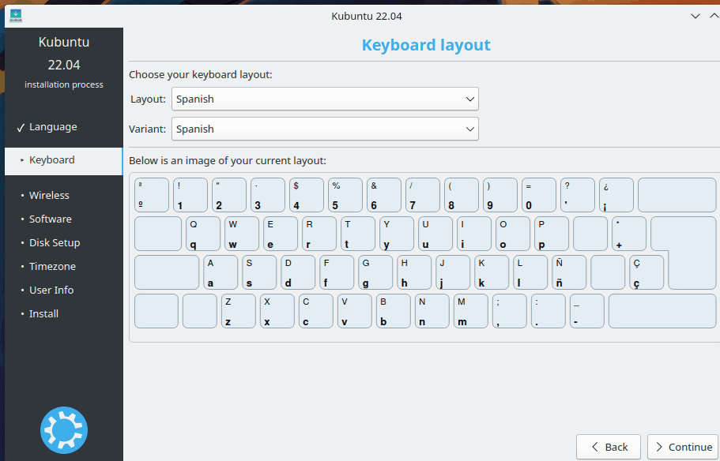

Pulsa **Continue** para seguir.

### 1.4 Red inalámbrica

Si el equipo tiene wifi, el instalador permite conectarse a una red. Es opcional: se puede omitir y configurar la red después. Conviene tener conexión para poder descargar actualizaciones.

> No hay captura de este paso.

### 1.5 Actualizaciones y otro software

Aquí se decide qué programas se instalan junto con el sistema:

| Opción | Qué incluye | Elegida |
|---|---|---|
| Instalación normal | Navegador, utilidades, paquete de oficina, reproductores multimedia y otros programas | No |
| **Instalación mínima** | Solo navegador y aplicaciones básicas | ✅ Sí |
| **Descargar actualizaciones al instalar Kubuntu** | Ahorra tiempo después de la instalación (solo se puede marcar si hay conexión a internet) | ✅ Sí |
| Instalar programas de terceros | Controladores gráficos, wifi y códecs multimedia adicionales (algunos son privativos) | No |

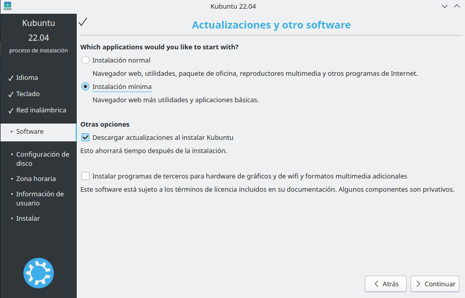

Se eligió la **instalación mínima**: el sistema queda más ligero y solo se instala lo que se necesita para el servidor. Se dejó marcada la descarga de actualizaciones durante la instalación y sin marcar el software de terceros.

Pulsa **Continuar**.

### 1.6 Tipo de instalación (disco)

Esta pantalla decide cómo se usa el disco duro:

| Opción | Significado |
|---|---|
| **Guiado - utilizar todo el disco** | El instalador borra el disco y lo particiona solo. Es la opción elegida y la más sencilla. |
| Guiado - disco completo con LVM | Igual, pero usando gestión de volúmenes lógicos |
| Guiado - LVM cifrado | Igual, y además cifra el disco con una contraseña |
| Manual | Tú creas y editas las particiones |

Debajo se selecciona el disco de destino: aquí, un disco virtual de **53,7 GB**. En la parte inferior, *Antes* y *Después* muestran cómo quedará el disco.

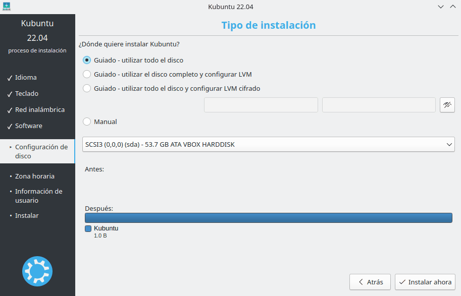

> ⚠️ **Se borra todo el contenido del disco seleccionado.** Comprueba que has elegido el disco correcto antes de continuar.

Pulsa **Instalar ahora**. El instalador pide confirmar los cambios en las particiones y, a partir de ahí, ya empieza a copiar archivos mientras se rellenan los datos de las siguientes pantallas.

### 1.7 Zona horaria

Sirve para que el reloj del sistema marque la hora local correcta y para usar los servidores de actualizaciones más cercanos. Se puede hacer clic en el mapa o elegir en los desplegables:

| Campo | Valor |
|---|---|
| Región | `España` |
| Huso horario | `hora de España` |

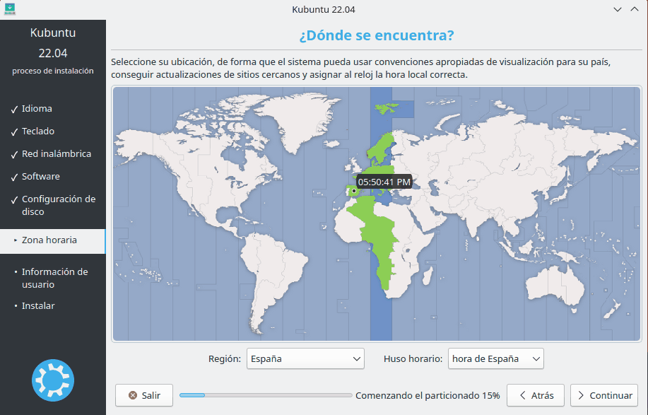

En la parte inferior se ve el progreso del particionado (*Comenzando el particionado 15%*): el instalador ya está trabajando en segundo plano. Pulsa **Continuar**.

### 1.8 Información de usuario

Aquí se crea la cuenta con la que se usará el sistema:

| Campo | Valor | Explicación |
|---|---|---|
| Su nombre | `Intermodular` | Nombre completo que se muestra en el sistema |
| Nombre de usuario | `intermodular` | Nombre con el que se inicia sesión y se usa en la terminal |
| Contraseña | *(la que elijas)* | Se escribe dos veces para evitar errores de teclado |
| Nombre del equipo | `intermodular-inter` | Nombre con el que el equipo se identifica en la red |
| Inicio de sesión | *Solicitar mi contraseña para iniciar sesión* | Más seguro que el inicio automático |

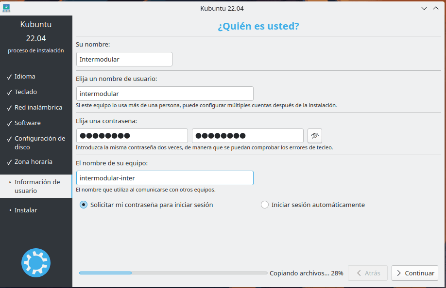

> Este usuario será **administrador**: podrá usar `sudo` para instalar programas, y esa contraseña es la que se pedirá en todos los comandos `sudo` de esta guía.

Pulsa **Continuar**. En la parte inferior se ve la copia de archivos (*Copiando archivos... 28%*).

### 1.9 Instalando

Mientras se copian e instalan los archivos, el instalador muestra una presentación con aplicaciones que se pueden instalar después desde **Discover** (Kdenlive, digiKam, Krita, Kdevelop, GCompris, Minuet, Peruse, Labplot…). La barra inferior indica el progreso (*Descargando fichero 1 de 3*).

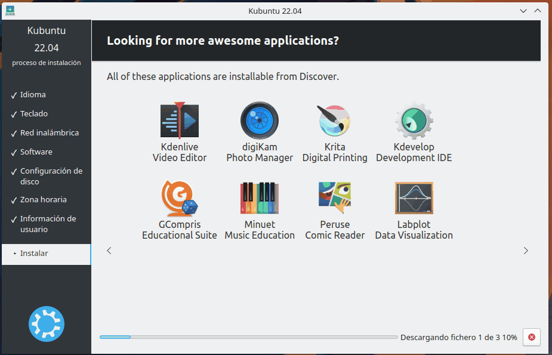

Cuando termine, el instalador pide **reiniciar el equipo**. Retira la ISO (o el medio de instalación), reinicia e inicia sesión con el usuario creado.

> Desde aquí todos los pasos se hacen en la **terminal**: abre **Konsole** (el terminal de KDE).

---

## 2. Instalación de Apache

**Apache** es el servidor web. Su trabajo es recibir las peticiones del navegador (por ejemplo, `http://servidor/`) y devolver las páginas o archivos pedidos.

```bash
sudo apt install apache2
```

Qué significa cada parte del comando:

| Parte | Significado |
|---|---|
| `sudo` | Ejecuta el comando con permisos de administrador (pide tu contraseña) |
| `apt` | Gestor de paquetes de Ubuntu |
| `install` | Instalar |
| `apache2` | Nombre del paquete de Apache |

**Qué muestra la terminal:**

- `apt` lee la lista de paquetes y calcula las dependencias.
- Indica que se instalarán **9 paquetes nuevos**, se descargarán unos **2.078 kB** y se usarán unos **8.276 kB** de disco.
- Pregunta `¿Desea continuar? [S/n]`: **escribe `s` y pulsa Intro**.

**Paquetes que se instalan:**

| Paquete | Función |
|---|---|
| `apache2` | Paquete principal |
| `apache2-bin` | Programa ejecutable del servidor |
| `apache2-data` | Archivos de datos (páginas por defecto, iconos) |
| `apache2-utils` | Herramientas auxiliares |
| `libapr1`, `libaprutil1`, `libaprutil1-dbd-sqlite3`, `libaprutil1-ldap` | Librerías que Apache necesita |
| `liblua5.3-0` | Librería Lua usada por un módulo de Apache |

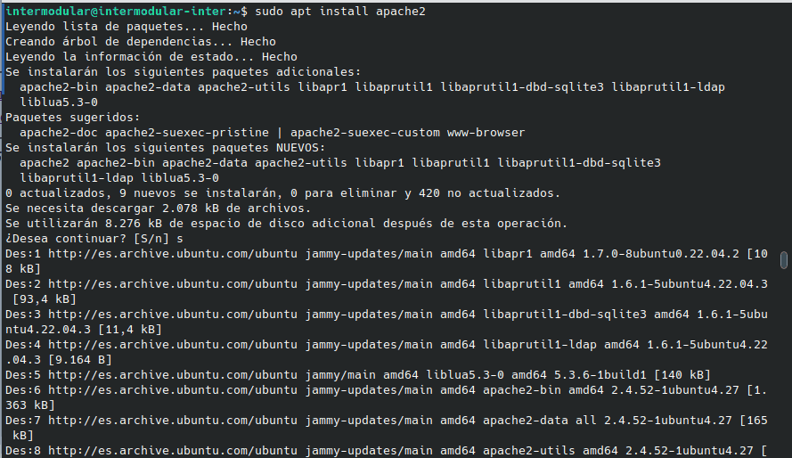

Al terminar, Apache queda **instalado y arrancado**. Puedes comprobarlo abriendo en el navegador `http://localhost`, donde aparece la página de bienvenida de Apache.

---

## 3. Instalación de MySQL

**MySQL** es el servidor de bases de datos: guarda la información de las aplicaciones de forma ordenada en tablas.

```bash
sudo apt install mysql-client mysql-server
```

Se instalan dos partes:

| Paquete | Función |
|---|---|
| `mysql-server` | El **servidor**: el programa que guarda y gestiona las bases de datos |
| `mysql-client` | El **cliente**: el programa de terminal para conectarse al servidor (`mysql`) |

**Qué muestra la terminal:**

- Se instalarán **20 paquetes nuevos**, se descargarán unos **29,4 MB** y se usarán unos **242 MB** de disco.
- Pregunta `¿Desea continuar? [S/n]`: **escribe `s` y pulsa Intro**.
- Además de `mysql-server-8.0`, `mysql-client-8.0`, `mysql-client-core-8.0`, `mysql-server-core-8.0` y `mysql-common`, se instalan librerías de apoyo (`libaio1`, `libevent-*`, `libmecab2`, `mecab-*`, `libfcgi-*`, `libhtml-template-perl`…).

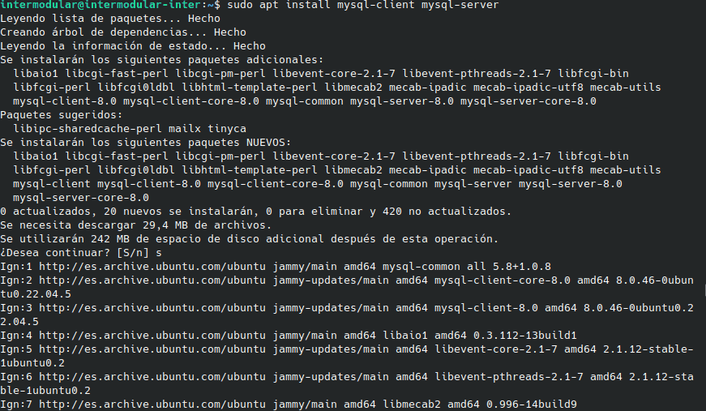

> En Ubuntu 22.04 el usuario `root` de MySQL se autentica con los permisos del sistema (por eso luego se entra con `sudo mysql`).

---

## 4. Instalación de PHP

**PHP** es el lenguaje de programación que Apache ejecuta en el servidor para generar páginas dinámicas. phpMyAdmin está escrito en PHP, así que es imprescindible.

```bash
sudo apt install php
```

**Qué muestra la terminal:**

- Se instalarán **3 paquetes nuevos**, se descargarán unos **1.779 kB** y se usarán unos **5.488 kB** de disco.
- Pregunta `¿Desea continuar? [S/n]`: **escribe `s` y pulsa Intro**.

| Paquete | Función |
|---|---|
| `php` | Metapaquete que instala la versión actual de PHP |
| `php8.1` | PHP versión 8.1 |
| `libapache2-mod-php8.1` | **Módulo que conecta Apache con PHP**, para que Apache sepa ejecutar archivos `.php` |

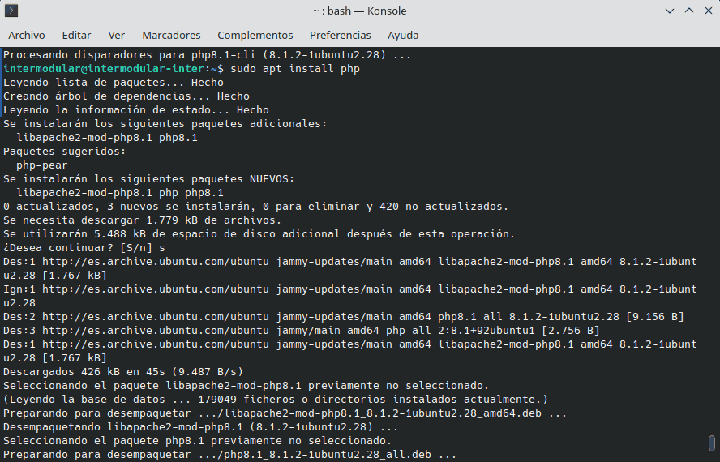

Al instalarse, el módulo se activa en Apache automáticamente.

---

## 5. Instalación de phpMyAdmin

**phpMyAdmin** es una aplicación web para gestionar MySQL desde el navegador: crear bases de datos y tablas, importar y exportar datos, administrar usuarios, ejecutar consultas SQL…

```bash
sudo apt install phpmyadmin
```

Esta instalación descarga muchos paquetes. Los más importantes son:

| Paquete | Función |
|---|---|
| `phpmyadmin` | La aplicación (versión 5.1.1) |
| `dbconfig-common`, `dbconfig-mysql` | Crean y configuran automáticamente la base de datos de phpMyAdmin |
| `php8.1-mysql` | Extensión de PHP para hablar con MySQL |
| `php8.1-mbstring` | Soporte de caracteres multibyte (acentos, ñ, UTF-8) |
| `php8.1-xml`, `php8.1-zip`, `php8.1-bz2`, `php8.1-curl`, `php8.1-gd` | Extensiones PHP para XML, compresión, conexiones web e imágenes |
| `php8.1-cli`, `php8.1-common`, `php8.1-opcache`, `php8.1-readline` | Componentes básicos de PHP |
| `libjs-jquery*`, `libjs-bootstrap4`, `libjs-codemirror`… | Librerías JavaScript de la interfaz |
| `php-twig`, `php-symfony-*`, `php-phpmyadmin-*` y otros `php-*` | Librerías PHP que usa la aplicación |

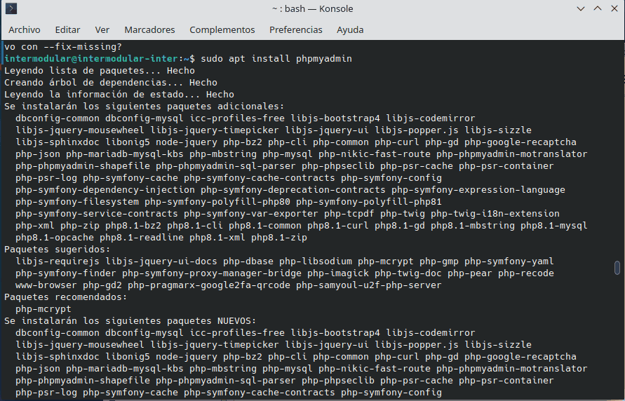

Pulsa `s` cuando pregunte si deseas continuar. Durante la instalación se abren **tres pantallas azules de configuración**. Se manejan con el teclado: **flechas/Tab** para moverte, **barra espaciadora** para marcar casillas e **Intro** para aceptar.

### 5.1 Elegir el servidor web

Pregunta qué servidor web debe configurarse automáticamente para ejecutar phpMyAdmin.

- Marca **`apache2`** con la **barra espaciadora** hasta que aparezca `[*]`.
- Deja `lighttpd` sin marcar (no lo usamos).
- Pulsa **Tab** hasta **`<Ok>`** y luego **Intro**.

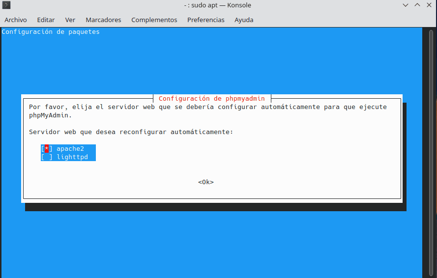

> ⚠️ Si no marcas `apache2` con la barra espaciadora, phpMyAdmin no se enlazará con Apache y no funcionará la dirección `/phpmyadmin`.

### 5.2 Configurar la base de datos con dbconfig-common

phpMyAdmin necesita una base de datos propia para guardar su configuración interna. Esta pantalla pregunta si quieres que `dbconfig-common` la cree y configure **automáticamente**.

- Elige **`<Yes>`** (es lo recomendado salvo que seas administrador avanzado y quieras hacerlo a mano).

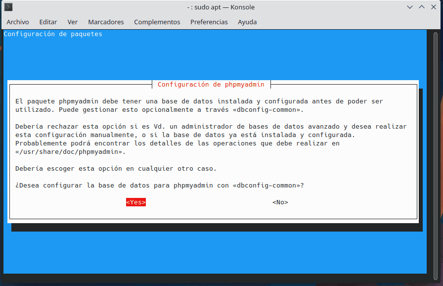

### 5.3 Contraseña de aplicación MySQL

Es la contraseña con la que **phpMyAdmin se registra en MySQL** para usar su propia base de datos. No es la contraseña con la que tú entrarás en phpMyAdmin.

- Escribe una contraseña (se ve como `********`) o déjala en blanco para que se genere una aleatoria.
- Pulsa **`<Ok>`**.

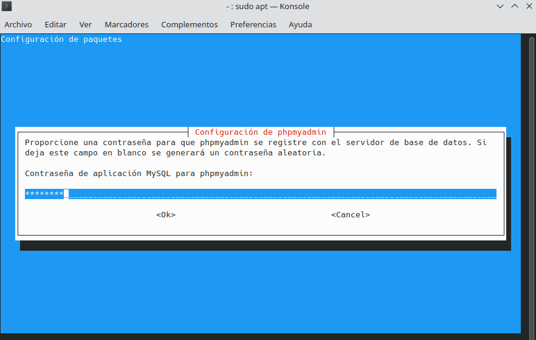

Al terminar, en MySQL aparece una nueva base de datos llamada `phpmyadmin`.

---

## 6. Creación de usuario MySQL

Si se entra en phpMyAdmin con `root`, el acceso suele fallar, porque `root` está pensado para usarse con `sudo` desde la terminal. La solución es crear un **usuario propio** con todos los permisos.

Entra en el cliente de MySQL como administrador:

```bash
sudo mysql -u root -p
```

| Parte | Significado |
|---|---|
| `sudo` | Permisos de administrador |
| `mysql` | Cliente de MySQL |
| `-u root` | Entrar con el usuario `root` de MySQL |
| `-p` | Pedir contraseña |

Se piden dos contraseñas: primero la de **`sudo`** (la de tu usuario de Kubuntu) y luego `Enter password:` de MySQL (si no se ha puesto ninguna, pulsa Intro). Cuando aparece el prompt `mysql>`, ejecuta estos tres comandos, uno por uno:

```sql
CREATE USER 'intermodular'@'localhost' IDENTIFIED BY '<CONTRASEÑA>';
GRANT ALL PRIVILEGES ON *.* TO 'intermodular'@'localhost' WITH GRANT OPTION;
FLUSH PRIVILEGES;
```

| Comando | Qué hace |
|---|---|
| `CREATE USER 'intermodular'@'localhost' IDENTIFIED BY '...'` | Crea el usuario `intermodular`, que solo puede conectarse desde el propio equipo (`localhost`), con la contraseña indicada |
| `GRANT ALL PRIVILEGES ON *.* TO ... WITH GRANT OPTION` | Le da **todos los permisos** (`ALL PRIVILEGES`) sobre **todas las bases de datos y tablas** (`*.*`), y además le permite dar permisos a otros usuarios (`WITH GRANT OPTION`) |
| `FLUSH PRIVILEGES` | Recarga la tabla de permisos para que los cambios se apliquen ya |

Cada comando debe responder `Query OK`. Para salir de MySQL escribe `exit;`.

> ⚠️ Sustituye `<CONTRASEÑA>` por una contraseña segura. Este usuario tiene control total sobre todas las bases de datos: úsalo solo en entornos de desarrollo o de confianza.

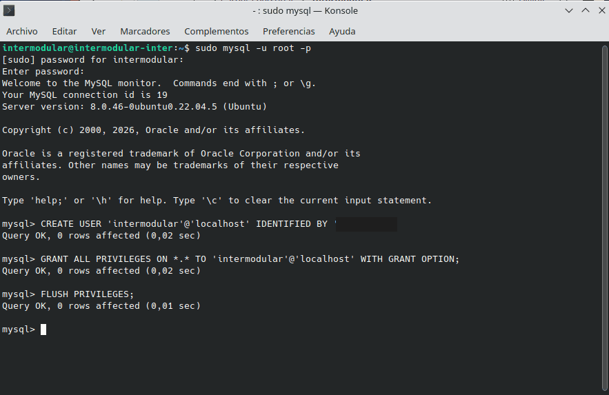

---

## 7. Publicar una carpeta en la web

Por defecto, Apache solo sirve la carpeta `/var/www/html`. Para ver en el navegador el contenido de otra carpeta (en este caso la del proyecto, dentro de la carpeta personal) se crea un **alias**.

### 7.1 Crear la carpeta

```bash
mkdir -p /home/intermodular/Intermodular
```

### 7.2 Editar la configuración de Apache

```bash
sudo nano /etc/apache2/sites-available/000-default.conf
```

Este es el archivo del **host virtual por defecto**. Baja hasta el final y añade, **antes** de la línea `</VirtualHost>`:

```apache
Alias /intermodular "/home/intermodular/Intermodular"
<Directory "/home/intermodular/Intermodular">
    Options Indexes FollowSymLinks
    AllowOverride All
    Require all granted
</Directory>
```

| Línea | Qué hace |
|---|---|
| `Alias /intermodular "..."` | Hace que la dirección `http://servidor/intermodular` muestre el contenido de esa carpeta del disco |
| `<Directory "...">` | Abre el bloque de configuración para esa carpeta |
| `Options Indexes FollowSymLinks` | `Indexes`: muestra el listado de archivos si no hay `index`. `FollowSymLinks`: permite seguir enlaces simbólicos |
| `AllowOverride All` | Permite usar archivos `.htaccess` dentro de la carpeta |
| `Require all granted` | Permite el acceso a cualquier visitante |

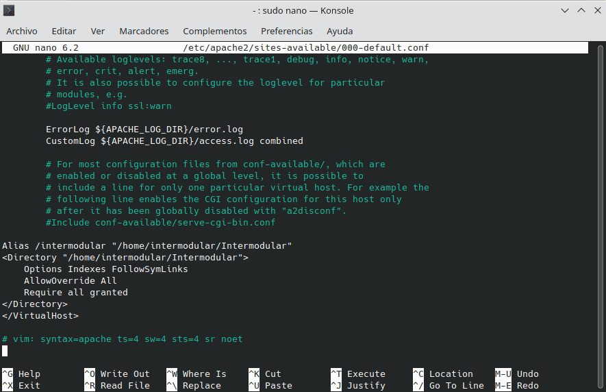

Guarda con **`Ctrl+O`** e **Intro**, y sal de nano con **`Ctrl+X`**.

### 7.3 Reiniciar Apache

Apache solo lee la configuración al arrancar, así que hay que reiniciarlo:

```bash
sudo systemctl restart apache2
```

> **Importante:** la carpeta debe existir y Apache (usuario `www-data`) debe poder leerla. Si aparece un error *403 Forbidden*, revisa los permisos de `/home/intermodular` y de la carpeta.

---

## 8. Comprobación final

### 8.1 phpMyAdmin

Abre el navegador y entra en:

```
http://<IP-DEL-SERVIDOR>/phpmyadmin
```

Inicia sesión con el usuario `intermodular` y la contraseña creada en el paso 6.

La pantalla de inicio confirma que todo está instalado correctamente:

| Zona de la pantalla | Qué indica |
|---|---|
| Servidor de base de datos | MySQL 8.0.46, conectado por socket UNIX como `intermodular@localhost` |
| Servidor web | Apache 2.4.52, PHP 8.1.2 y las extensiones `mysqli`, `curl` y `mbstring` |
| phpMyAdmin | Versión 5.1.1 |
| Panel izquierdo | Bases de datos: `information_schema`, `mysql`, `performance_schema`, `phpmyadmin` y `sys` |

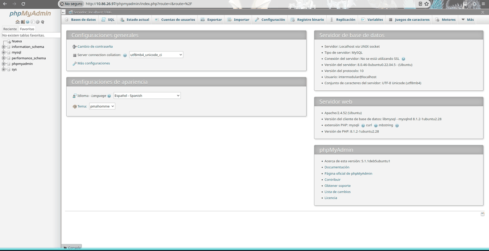

### 8.2 Carpeta publicada

Entra en:

```
http://<IP-DEL-SERVIDOR>/intermodular/
```

Debe aparecer el listado **Index of /intermodular**. Está vacío (solo el enlace *Parent Directory*) porque la carpeta aún no tiene archivos, pero confirma que el alias de Apache funciona. En cuanto metas archivos en esa carpeta, aparecerán aquí.

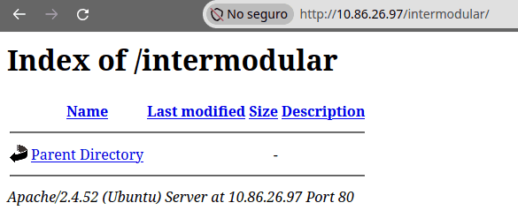

> Para saber la IP del servidor, ejecuta `ip a` en la terminal y busca la dirección de la red (en este caso `10.86.26.97`).

---

## ✅ Resumen de comandos

```bash
# 1. Servidor web
sudo apt install apache2

# 2. Base de datos
sudo apt install mysql-client mysql-server

# 3. PHP
sudo apt install php

# 4. phpMyAdmin (elegir apache2 con la barra espaciadora, dbconfig = Yes, contraseña)
sudo apt install phpmyadmin

# 5. Usuario MySQL
sudo mysql -u root -p
#   CREATE USER 'intermodular'@'localhost' IDENTIFIED BY '<CONTRASEÑA>';
#   GRANT ALL PRIVILEGES ON *.* TO 'intermodular'@'localhost' WITH GRANT OPTION;
#   FLUSH PRIVILEGES;

# 6. Publicar carpeta
sudo nano /etc/apache2/sites-available/000-default.conf
sudo systemctl restart apache2
```

🎉 **¡Listo! Tu servidor LAMP está funcionando.**
